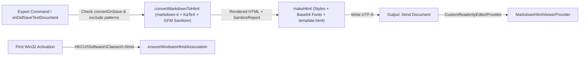

# Technical Documentation — Markdown HTML

This engineering reference covers the `markdown-it` conversion pipeline, asset and font inlining, raw HTML sanitization, custom `.htmd` viewer, Windows per-user `.htmd` registration, full settings schema, and packaging workflow across [`src/extension.ts`](../src/extension.ts), [`src/utils.ts`](../src/utils.ts), [`src/html-viewer.ts`](../src/html-viewer.ts), and [`src/windows-association.ts`](../src/windows-association.ts).

## 1. Architecture & Repository Layout

```text
vscode-extension-markdown-html/
├── .gitignore                        # Ignores *.htmd, node_modules/, dist/, *.vsix, .DS_Store
├── .vscodeignore                     # Excludes src/, tsconfig.json, docs/, .agents/, **/*.htmd; keeps highlight.js styles
├── license.md                        # MIT license
├── package.json                      # Manifest declaring viewer, commands, settings & esbuild scripts
├── tsconfig.json                     # TypeScript compiler configuration
├── readme.md                         # User guide, features & usage
├── docs/
│   └── technical.md                  # Architecture, settings/frontmatter contracts, sanitization & packaging
├── src/
│   ├── extension.ts                  # Activation hook, commands, save listener & export pipeline
│   ├── html-viewer.ts                # MarkdownHtmlViewerProvider (CustomReadonlyEditorProvider)
│   ├── windows-association.ts        # Per-user HKCU .htmd file association & browser resolution
│   ├── utils.ts                      # Frontmatter parser, CSS/Base64 builders & sanitizeRawHtml
│   ├── logger.ts                     # OutputChannel logging facade decoupled from vscode
│   ├── math-renderer.ts              # KaTeX renderMath helper with macro merging
│   ├── markdown-it-checkbox.ts       # Task list checkbox token transformer
│   ├── markdown-it-named-headers.ts  # GitHub-compatible heading slugifier & duplicate suffixing
│   ├── markdown-it-github-alerts.ts  # GitHub Alert blockquote-to-callout plugin
│   ├── markdown-it-math-brackets.ts  # \(...\) and \[...\] inline and display math rules
│   ├── markdown-it-math-fence.ts     # ```math fenced code block KaTeX renderer
│   ├── markdown-it-sanitize.ts       # html_block and html_inline sanitization hooks
│   └── types/
│       └── markdown-it-emoji.d.ts    # Ambient type declarations for markdown-it-emoji
├── styles/
│   ├── markdown-vscode-light2026.css # Default light theme stylesheet
│   ├── markdown-vscode-dark2026.css  # Default dark theme stylesheet
│   ├── tomorrow.css                  # Default highlight.js code block theme
│   └── katex/                        # Bundled katex.min.css and .woff2/.woff/.ttf font files
└── template/
    └── template.html                 # HTML wrapper with conditional Mermaid script & data-source tag
```



## 2. Markdown-to-`.htmd` Conversion Pipeline

Triggering `extension.markdown-html.export` or saving a Markdown file under `onDidSaveMarkdownDocument` delegates to [`exportDocumentToHtml`](../src/extension.ts#L165), which exports `convertMarkdownToHtml` and `makeHtml` so both VS Code events and companion tools share identical output. [`convertMarkdownToHtml`](../src/extension.ts#L211) first parses optional YAML frontmatter via [`parseFrontMatter`](../src/utils.ts#L488), initializes `markdown-it` with `buildHighlightCallback`, and registers plugins in strict order: `markdownItCheckbox`, `markdownItEmojiFull`, `markdownItNamedHeaders`, `markdownItGitHubAlerts`, and the KaTeX suite (`@vscode/markdown-it-katex`, [`mathBracketsPlugin`](../src/markdown-it-math-brackets.ts) registered before `'escape'` and `'fence'` so `\(...\)` and `\[...\]` survive escape processing, and [`mathFencePlugin`](../src/markdown-it-math-fence.ts) wired through [`renderMath`](../src/math-renderer.ts)).

Asset inlining, link rewriting, and styling occur synchronously so exported `.htmd` files remain portable offline. `md.renderer.rules.image` calls [`inlineImageHref`](../src/utils.ts#L166) to convert relative local images (`png`, `jpg`, `jpeg`, `gif`, `svg`, `webp`, `bmp`, `ico`) into Base64 `data:` URIs. `md.renderer.rules.link_open` calls [`rewriteMarkdownLinkHref`](../src/utils.ts#L523) and [`installSanitizeRules`](../src/markdown-it-sanitize.ts) applies [`rewriteHtmlAnchorHrefs`](../src/utils.ts#L557) to raw `<a>` elements so relative `.md` and `.markdown` links rewrite to `.htmd` while preserving query strings and `#fragments` and leaving external URLs, pure `#anchors`, and code blocks untouched. [`buildStyleTags`](../src/utils.ts#L324) embeds `highlight.js` CSS alongside `"markdown.styles"` (inherited automatically from [vscode-extension-markdown-stylesheets](https://github.com/tbruneel/vscode-extension-markdown-stylesheets)) and `"markdown-html.styles"`, falling back to `markdown-vscode-light2026.css` or `markdown-vscode-dark2026.css` when `includeDefaultStyles` is enabled and no custom styles are active. [`buildKatexStyleTag`](../src/utils.ts#L129) inspects rendered HTML for `class="katex` and only embeds `katex.min.css` plus Base64 WOFF2/WOFF/TTF fonts when math is actually present. Finally, `makeHtml` computes the relative `.md` path (`data-source` in [`template/template.html`](../template/template.html)) and emits the Mermaid CDN loader only when a `class="mermaid"` diagram exists.

## 3. Built-In `.htmd` Viewer & Windows Association

[`MarkdownHtmlViewerProvider`](../src/html-viewer.ts#L42) implements `vscode.CustomReadonlyEditorProvider` for `viewType = 'markdown-html.viewer'` on `*.htmd` (`priority: "default"`). It maintains normalized path mappings in `activePanels`, reloads open webviews via both `refreshFile` and `vscode.workspace.createFileSystemWatcher`, injects `ANCHOR_NAV_SCRIPT` before `</body>` for smooth `#id` scrolling and relative local-link navigation (forwarding non-external relative links through `webviewPanel.webview.onDidReceiveMessage` -> `vscode.open`), and pairs with [`resolveSourceMdFilename`](../src/utils.ts#L583) to read the `<meta name="generator" content="vscode-markdown-html" data-source="...">` header before falling back to sibling `.md` resolution when `extension.markdown-html.showSource` runs.

On first activation on Windows (`process.platform === 'win32'`, tracked via `globalState` key `'htmdAssociationInitialized'`), [`ensureWindowsHtmdAssociation`](../src/windows-association.ts#L140) configures per-user `.htmd` shell handling via `reg.exe` without requiring Administrator elevation. It reads the active `.html` handler from `HKCU\...\Explorer\FileExts\.html\UserChoice` (falling back to installed Chrome or Edge executables), maps `HKCU\Software\Classes\.htmd` to `MarkdownHTML.htmd` with `Content Type = text/html` so Chromium renders `.htmd` files inline instead of downloading them, clears conflicting `OpenWithList` entries if no explicit `.htmd` `UserChoice` exists, and flushes Explorer caches via `ie4uinit.exe -show` and Win32 `SHChangeNotify`. The standalone `powershell-markdown-html` utility shares this exact registry schema for external diagnostics and re-syncing.

## 4. Commands, Settings & Frontmatter Reference

| Contribution ID | Kind | Where Exposed | Behavior |
| :--- | :--- | :--- | :--- |
| `extension.markdown-html.export` | Command | Editor toolbar, Explorer/editor context menu, Command Palette | Exports the target `.md` file immediately using active settings. |
| `extension.markdown-html.showSource` | Command | Viewer toolbar, Command Palette | Opens the source `.md` file resolved from metadata or sibling path. |
| `markdown-html.viewer` | Custom Editor | `*.htmd` default editor | Renders exported HTML read-only inside VS Code with live reload. |

| Setting | Type | Default | Description |
| :--- | :--- | :--- | :--- |
| `markdown-html.convertOnSave` | `string` | `"ifExists"` | Auto-export policy on save: `"ifExists"`, `"always"`, or `"never"`. |
| `markdown-html.convertOnSaveExclude` | `string[]` | `[]` | Regex patterns matched against filenames excluded from save export. |
| `markdown-html.styles` | `string[]` | `[]` | Local paths or URLs to extra CSS stylesheets inlined during export. |
| `markdown-html.stylesRelativePathFile` | `boolean` | `false` | Resolve relative `markdown-html.styles` entries from the `.md` folder. |
| `markdown-html.includeDefaultStyles` | `boolean` | `true` | Inline default Light/Dark 2026 CSS when `markdown.styles` and `styles` are empty. |
| `markdown-html.outputDirectory` | `string` | `""` | Destination folder for `.htmd` outputs (empty keeps sibling `.htmd`). |
| `markdown-html.outputDirectoryRelativePathFile` | `boolean` | `false` | Resolve relative `outputDirectory` paths from the `.md` folder. |
| `markdown-html.sanitize` | `string` | `"gfm"` | Raw HTML sanitization mode: `"gfm"`, `"gfm-allow-style"`, or `"none"`. |
| `markdown-html.highlight` | `boolean` | `true` | Enable `highlight.js` syntax highlighting on fenced code blocks. |
| `markdown-html.highlightStyle` | `string` | `""` | Optional `highlight.js` CSS filename (falls back to `tomorrow.css`). |
| `markdown-html.breaks` | `boolean` | `false` | Convert single newlines in paragraphs into `<br>` tags. |
| `markdown-html.emoji` | `boolean` | `true` | Enable `:shortcode:` Unicode emoji expansion. |
| `markdown-html.mermaidServer` | `string` | `"https://unpkg.com/mermaid/dist/mermaid.min.js"` | Mermaid runtime URL emitted only when ```` ```mermaid ```` blocks appear. |
| `markdown-html.math.enabled` | `boolean` | `true` | Enable KaTeX math rendering across delimiters and ```` ```math ```` fences. |
| `markdown-html.math.katex.macros` | `object` | `{}` | String map of custom KaTeX macros forwarded to `renderMath`. |
| `markdown-html.StatusbarMessageTimeout` | `number` | `5000` | Status bar confirmation timeout in milliseconds after export. |

| Frontmatter Key | Type | Overrides | Behavior |
| :--- | :--- | :--- | :--- |
| `breaks` | `boolean` | `markdown-html.breaks` | Controls `<br>` conversion per document when defined as boolean. |
| `emoji` | `boolean` | `markdown-html.emoji` | Enables or disables `:emoji:` shortcodes per document. |
| `math.enabled` | `boolean` | `markdown-html.math.enabled` | Toggles KaTeX rendering for the document. |
| `math.katex.macros` | `Record<string, string>` | Merged over `markdown-html.math.katex.macros` | Per-document KaTeX macro overrides merged on top of workspace settings. |

## 5. HTML Sanitization & Safety Boundaries

[`installSanitizeRules`](../src/markdown-it-sanitize.ts) intercepts `html_block` and `html_inline` tokens and passes raw markup to [`sanitizeRawHtml`](../src/utils.ts#L752). Under `"gfm"`, disallowed elements are `title`, `textarea`, `style`, `xmp`, `iframe`, `noembed`, `noframes`, `script`, and `plaintext`; in block context `style`, `script`, and `iframe` are stripped together with their inner contents, whereas inline tags are HTML-escaped. Switching to `"gfm-allow-style"` retains `<style>` blocks, and `"none"` bypasses filtering completely. For permitted elements, `stripDangerousAttributes` strips `on*` event attributes and `javascript:` values in `href` or `src`, logging counts in `SanitizeReport` and prompting the user on manual exports when content is modified.

## 6. Build, Debug & Packaging

```powershell
# Install dependencies and type-check
npm install
npm run check

# Bundle dist/extension.js with esbuild
npm run build

# Verify included files and package into a local .vsix archive
npx @vscode/vsce ls
npx @vscode/vsce package
```

Packaging omits `--no-dependencies` intentionally because [`.vscodeignore`](../.vscodeignore) blocks `node_modules/**` while whitelisting `!node_modules/highlight.js/styles/**` so optional `highlightStyle` themes remain available at runtime alongside `dist/extension.js`, `styles/`, `template/template.html`, `package.json`, `license.md`, and `readme.md` (excluding `src/**`, `docs/**`, `.agents/**`, and `**/*.htmd`).
